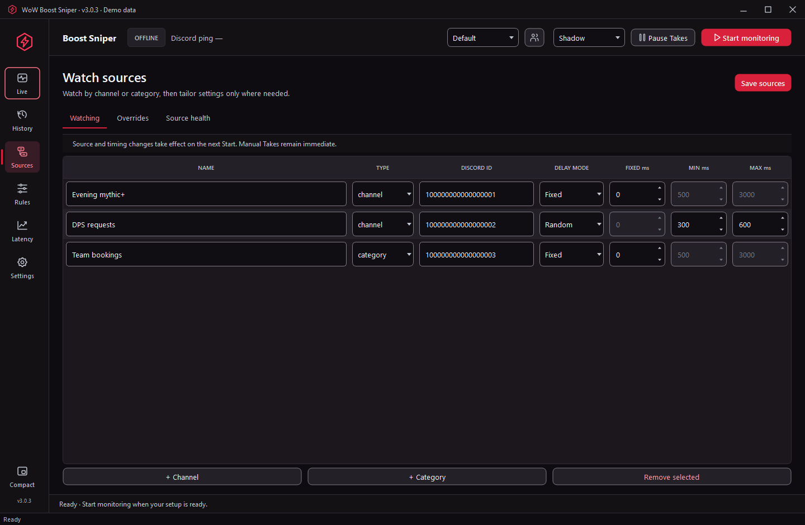
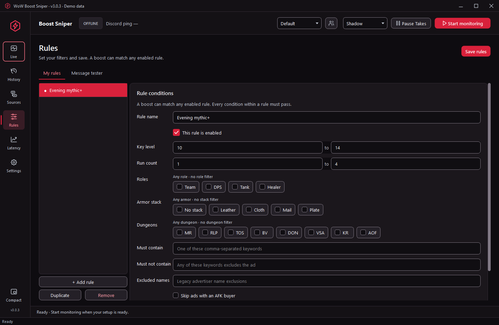
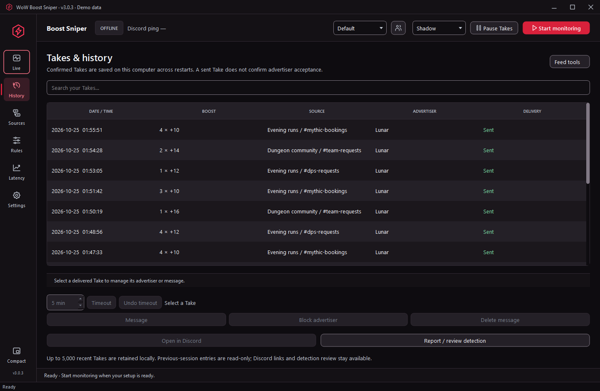

# Using WoW Boost Sniper

[Download the latest Windows release](https://github.com/tnt1576-a11y/wow-boost-sniper-personal/releases/latest) · [Back to the overview](README.md)

## 1. Download and open

Download **`discordwatcher-3.0.3-personal-offline.exe`** from the release assets. Use the EXE asset, rather than GitHub's automatically generated source archive: that archive contains this repository's documentation.

Place the EXE in its own writable folder on a **Windows x64** computer. It is a portable, Nuitka-compiled application; a separate Python installation is unnecessary. Keep one copy running at a time. Do not open an older copy while the current app is using the same setup.

The app opens directly. It does not contact a release server to check your version, register your device or obtain permission to run. “Offline” describes that standalone startup: Discord monitoring and message delivery still need an internet connection.

To compare the downloaded file with its release checksum in PowerShell:

```powershell
Get-FileHash .\discordwatcher-3.0.3-personal-offline.exe -Algorithm SHA256
```

Compare the result with the value in the release's `SHA256SUMS.txt` asset.

## 2. Configure your account

Open **Settings → Account** and enter your own account configuration. Treat the Discord token like a password. Never send it in an issue, screenshot or support message.

Use the app's proxy field if your connection requires one. **Detect system proxy** can populate the field; review the detected value before saving. A startup without version verification does not test whether your Discord connection or proxy works.

Save the settings. To bring in a setup you already own, use **Import existing configuration…** and select the file explicitly. The app does not search other installations or combine their configurations automatically.

The sidebar labels **History** and **Latency** open the Takes / History and Performance workspaces described below.

## 3. Add watch sources

Open **Sources** and add the channels or categories you want to monitor. Enter the source ID and a useful label. Categories are useful for booking systems that create a new channel for each opportunity.

Each source can have a fixed delay or an optional random delay range for automatic Takes. Random replaces that source's fixed delay, with one draw for each automatic Take. Manual Takes remain immediate. Stop and restart monitoring after changing source timing.

Source overrides let you customize rules, role mappings, dungeon aliases and outgoing messages for a specific server or channel.



## 4. Save and test rules

Open **Rules**, configure the filters you need and select **Save rules**. Available filters include key levels, run counts, roles, armor, dungeon choices, keywords and AFK handling.

Use the local message tester to inspect parsing and matching without sending anything. Keep the dungeon list and aliases aligned with the bookings you actually watch; they are editable in Settings and source overrides.

Begin with a small, understandable rule set. Check representative bookings that should match and examples that should be rejected.



## 5. Choose a monitoring mode

Stop monitoring before changing modes. Resolve unsaved edits when prompted, then start the selected mode.

| Mode | Suggested workflow |
| --- | --- |
| **Shadow** | Start here. Review detected bookings, match reasons and source behavior without sending Takes. |
| **Manual** | Select a Boost in Live, inspect the original message, edit your Take text if needed and press Take. Use Skip for bookings you do not want. |
| **Auto** | Enable the rules you want to act on. Matching bookings use your saved Take message, source timing and safety limits. |
| **DM mode** | Set a nonempty **DM message** under **Settings → Taking and safety → DM mode**, save settings and enable matching rules. Matching bookings send that message to the advertiser. There is no boost-channel fallback when DMs are unavailable. |

DM text can span multiple lines, up to 2,000 characters. Keep normal Take text configured too. DM mode follows the same source, timing, cooldown, hourly-limit, Busy and delivery-protection rules as Auto.

## 6. Work in Live and History

**Live → Boosts** contains the detected opportunities. Use search and the state filter to find an item. A gold star marks a new arrival until you intentionally inspect it with the mouse or keyboard. Background updates do not mark it as read.

The detail area shows the original booking and detection information. The activity pane has text/category filters, Copy, Clear, Follow and an expanded view. Scrolling up pauses following the latest log entries.

**Takes / History** shows confirmed deliveries. When available for the active session and account, actions include advertiser timeout and undo, Message, Block, Delete message and Open in Discord. Deleting a sent message is a real Discord action.

Earlier-session history remains read-only. The app keeps up to 5,000 confirmed records locally; it does not restore old opportunities as pending Takes or resume old sessions. Clearing a view or completed timing analytics does not erase the durable delivery safeguards or Take archive.

Open **Compact** for a smaller monitor. Its latest card changes after a successful Take, and it shares the main window's action checks.



## 7. Use Busy, Stop and delivery review

**Busy** pauses Take admission. **Stop** ends monitoring and invalidates queued or delayed work. Always allow shutdown to finish before opening another copy or moving the data files.

If a send's outcome is uncertain, review it in **Performance** before continuing. Avoid immediately retrying an uncertain delivery: the original request may have reached Discord even when confirmation was unavailable.

Performance shows recorded per-attempt stages and percentile summaries. Unknown measurements remain unknown. The Gateway ping in the command bar is a separate measurement from detection and delivery time.

The optional remote DM pause control lives under **Settings → Safety**. Configure its password and optional trusted-user IDs, then save that control. It accepts authorized one-to-one pause DMs for the active connection; it does not provide remote resume. This is a user-configured pause feature, separate from the removed release-server controls.

## Appearance, profiles and notifications

Choose one of six themes in **Settings → Appearance**. The theme is global, saves immediately and can change without restarting monitoring. Red/Black is the default. The interface animation toggle applies to the current session.

Profiles store monitoring setups. Use **Save current**, **New from current** and **Use selected** to manage them. Theme selection and the independently saved remote pause control do not depend on profile drafts.

Settings also contains notification previews, Test sound, advertiser metadata, role/dungeon editors, Show detection log and an allowlisted support-report preview/export. Review any report before sharing it.

## Data, backups and manual updates

By default, data is stored beside the EXE. A configuration directly beside the EXE takes precedence over an existing `data/wow_sniper_config.json`. With no existing config in either place, the EXE folder is used. Source or extraction folders are not searched for other installations.

To choose a separate local folder:

```powershell
.\discordwatcher-3.0.3-personal-offline.exe --data-dir "D:\BoostSniperData"
```

Important local files include:

| File or folder | Purpose |
| --- | --- |
| `wow_sniper_config.json` | Account credentials and saved settings; keep private. |
| `delivery_journal.json` | Durable protection and delivery state; keep private. |
| `take_history.sqlite3` | Confirmed Take archive. |
| `latency.sqlite3` / `performance_history.json` | Recorded performance data. |
| `detection_log.jsonl` | Detection details; may contain private source content. |
| `private/upgrade-backups/` | Verified upgrade backups; may contain credentials. |

For an update, stop and close the app, back up its full data directory, then download the new EXE manually. Keep the configuration and data in the intended folder. There is no automatic download or updater handoff in this edition.

Backups and data files are not release assets. Never commit or upload them.

## Troubleshooting

| Symptom | What to check |
| --- | --- |
| Another copy is already open | Close the existing app and let its connection and writers finish. |
| Cannot open saved setup | Check folder permissions and the integrity of your local backup. Do not delete your configuration as a first step. |
| Sources show no opportunities | Check the Discord connection, source IDs, category selection and detection activity. Test a representative message locally. |
| A booking does not match | Check the displayed reason, enabled rules, role mappings, dungeon aliases and source overrides. |
| Auto or DM mode sends nothing | Check Busy, cooldown, hourly limit, enabled rules, message configuration and unresolved deliveries. |
| A historical action is unavailable | Earlier-session records are read-only; live actions require the appropriate active account and session. |
| You need help | Preview a support report, remove anything private and share only the relevant details. Never share your token or full config. |

Personal-account automation is against Discord's rules and may put an account at risk. A sent Take does not guarantee the advertiser will accept it.
