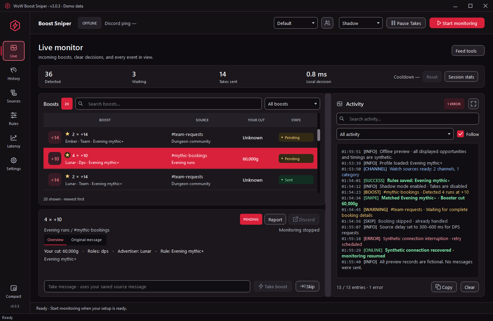
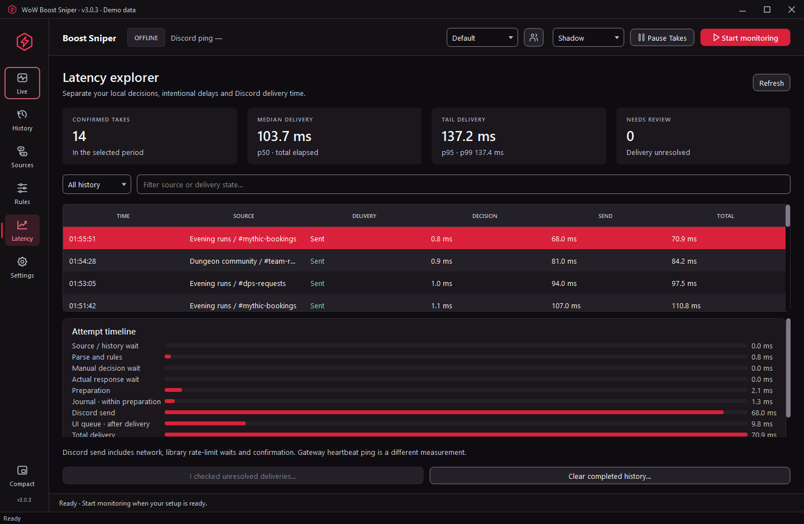
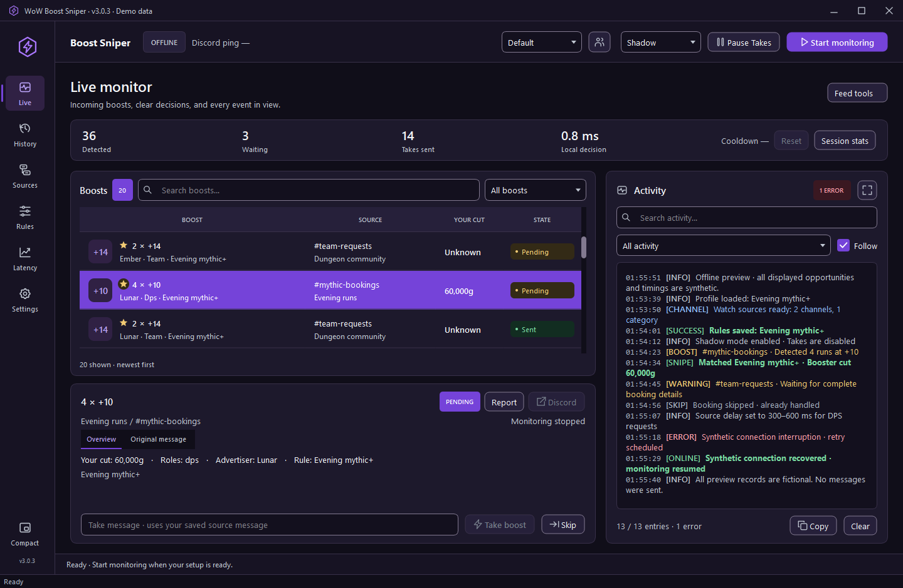
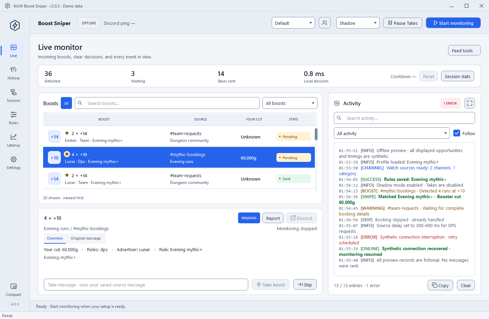
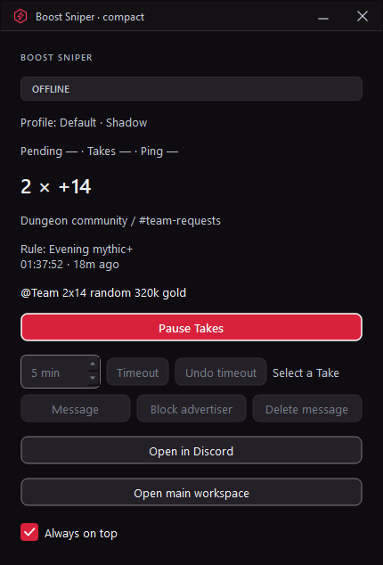

  

<h1 align="center">WoW Boost Sniper</h1>

A focused Windows desktop companion for finding and taking WoW boosts.

  
  

  <a href="https://github.com/tnt1576-a11y/wow-boost-sniper-personal/releases/latest"><strong>Download the Windows EXE</strong></a>
  &nbsp; · &nbsp;
  <a href="GUIDE.md"><strong>Getting started</strong></a>

## Your boosts, in one place

Watch selected Discord channels and categories, filter bookings with your own rules, and keep the details close at hand. The desktop interface brings live opportunities, delivery history, source configuration and performance review into six workspaces.

Run it as a portable Windows application, with no separate Python installation required. Configure your account, choose your watch sources and start with Shadow mode to explore how your rules match incoming bookings. Discord monitoring requires an internet connection.

## Choose how you work

| Mode | What it does |
| --- | --- |
| **Shadow** | Observe detection and rule matches without sending Takes. A useful first step while checking your setup. |
| **Manual** | Inspect a boost, edit the Take message if needed, then choose Take or Skip. |
| **Auto** | Automatically Take matching bookings using your saved rules and timing settings. |
| **DM mode** | Automatically send your configured message to the advertiser when a booking matches your rules. |

## Features

- **A clear Live workspace.** Search and filter Boosts, inspect original posts, see why a rule matched, and follow a resizable activity log. Gold stars distinguish new arrivals until you deliberately inspect them.
- **Rules built for WoW bookings.** Filter by key level, run count, roles, armor, dungeons, keywords and AFK preferences. Test example messages locally before using the rules. Dungeon names and aliases remain editable for future seasons.
- **Control over every source.** Watch channels or categories, choose fixed or random Auto Take delays, and apply source-specific rules, role mappings, dungeons and messages.
- **Useful actions after a Take.** Review confirmed deliveries, open Discord links, message or block advertisers, manage timeouts and undo them, or delete your sent message when that action is available for the active session.
- **History that survives restarts.** Keep up to 5,000 confirmed Takes locally. Previous-session entries remain read-only, with source and booking details available for review.
- **Delivery safeguards.** Busy and Stop gates, cooldowns, hourly limits, duplicate-delivery protection and unresolved-delivery review help keep account actions controlled. Uncertain delivery pauses further Takes for review.
- **A compact monitor.** Keep the latest successful Take and its available actions in a small window beside your main workspace.
- **Performance you can inspect.** Review recorded attempt timings, stage breakdowns and p50/p95/p99 measurements. Discord Gateway ping is shown separately from detection and send timing.
- **Personal settings.** Saved profiles, editable notifications and sounds, advertiser notes, proxy settings, a support-report preview and an optional password-protected DM pause control.
- **Six built-in themes.** Red/Black, Purple Arcane, Blue Frost, Green Fel, Orange Sunrise and Minimal Light. Change appearance immediately without restarting the app.

## A closer look

### Rules and sources

Build your filters, then decide where and when they apply.

| Rules | Sources |
| --- | --- |
|  |  |

### History and performance

See what was sent and examine the recorded timing stages.

| Takes / History | Performance |
| --- | --- |
|  |  |

### Make it yours

| Purple Arcane | Minimal Light |
| --- | --- |
|  |  |

### Compact monitor

Keep the latest successful Take close by in a smaller window.

## Start in a few minutes

1. Download `discordwatcher-3.0.3-personal-offline.exe` from the [latest release](https://github.com/tnt1576-a11y/wow-boost-sniper-personal/releases/latest).
2. Put it in its own writable folder on your Windows PC, then open it.
3. Configure your own Discord account, watch sources and rules. Keep the account token private.
4. Start with **Shadow** and confirm the detections and matches look right.
5. Choose Manual, Auto or DM mode when you are ready to use their account actions.

The [usage guide](GUIDE.md) covers setup, modes, data, backups and troubleshooting. Release assets include a SHA-256 checksum for the EXE.

## Local data and updates

Your configuration and history stay in the app's selected local data directory. The default is the folder beside the EXE; an existing `data` subfolder with a configuration can also be used. An explicit `--data-dir` selects a different folder.

To update, close the app, back up your data, and download the new executable from [GitHub Releases](https://github.com/tnt1576-a11y/wow-boost-sniper-personal/releases/latest). Keep your account configuration and backups private.

## Account notice

This tool automates a **personal Discord account** using `discord.py-self`. Personal-account automation is against Discord's rules and may result in account restrictions. Understand that risk before configuring an account. A confirmed Take means your message was sent; it does not mean the advertiser accepted your booking.

Do not put account tokens or private messages in issues or screenshots. Check exported support reports before sharing them.
